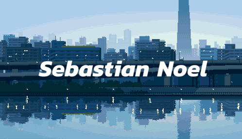

  

<h3 align="center">returning swe intern @ <a href="https://www.bny.com/corporate/global/en.html">bny</a> | swe lead @ <a href="https://github.com/GraphicsProgrammingKnights/gpkweb">gpk</a> | outreach board @ <a href="https://club.knighthacks.org/">knight hacks</a></h3>

  cs @ <a href="https://www.ucf.edu/">ucf</a> (robotics minor) &middot; prev swe intern @ <a href="https://www.ist.ucf.edu/">ucf-ist</a> 
  prev computer vision research @ <a href="https://www.crcv.ucf.edu/">crcv</a> &middot; 5x <a href="https://devpost.com/sebastian-noel">hackathon winner</a>

<h3 align="center">contact / connect: <a href="mailto:snoel.dev@gmail.com">snoel.dev@gmail.com</a></h3>

  
  

